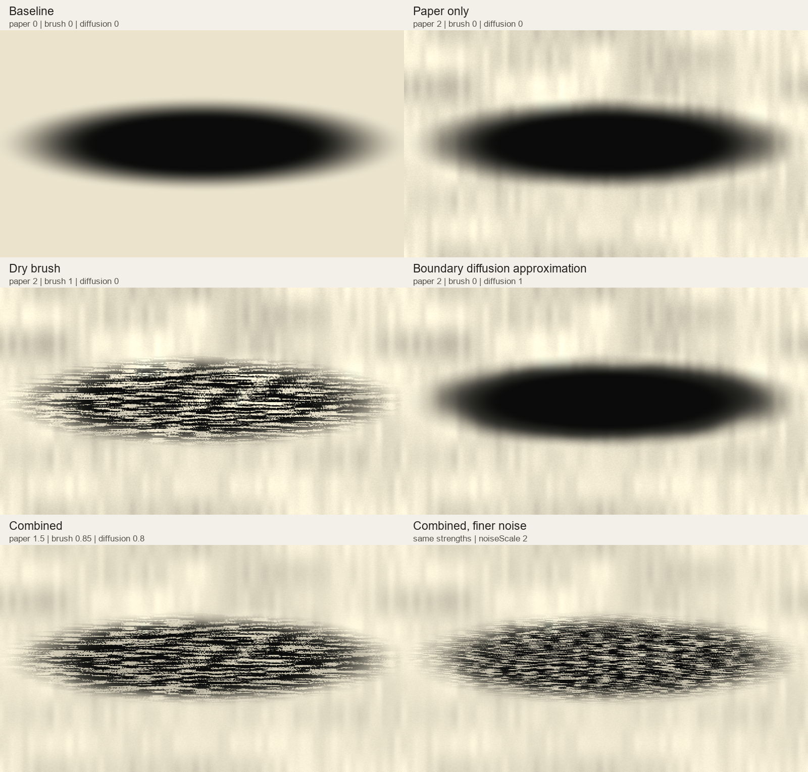

# Member 4: paper, brush noise, and diffusion prototype

This is the first-stage **paper-inspired, single-pass module**, not the final
integrated renderer or a physical ink simulation.

## Delivered files

- `Terrain/PaperTexture.h/.cpp`: deterministic, low-contrast paper texture.
- `openGLHelper/inkPaperFragment.glsl`: paper compositing, dry brush, and
  irregular soft tone boundaries.
- `comparison.png`: actual OpenGL framebuffer captures, arranged with labels.

Shared scene code, build projects, binaries, and other members' shaders are not
part of this module commit. The default application does not load this module
until the team performs the integration below.

## Effects and methods

**Paper:** CPU-generated scalar value noise on an 8 x 8 grid provides broad
variation. A 64 x 8 grid adds elongated fiber-like structure, and independent
uniform noise adds fine grain. Cubic interpolation smooths each grid.
The result is centered at 0.5, bounded approximately by 0.3975–0.6025 before
8-bit quantization. A fixed seed produces the same texture.

This is value noise, not gradient/Perlin noise. The module reuses the course
`Texture` uploader without depending on the terrain's global gradient grid.

**Dry brush:** high-frequency, anisotropic value noise produces elongated gaps.
Box–Muller transforms two hashed samples into approximately Gaussian grain.
A smooth threshold produces coverage, which multiplies ink density.
The brush-strength control blends between intact ink and broken coverage.
Gaussian describes the sample distribution; smoothness/correlation is a separate
property. GPU hash quality is approximate, not a statistical noise guarantee.

**Diffusion approximation:** low-frequency value noise perturbs an incoming tone.
A widened smoothstep and an edge weight soften and vary partially inked regions:

```text
wet = smoothstep(-0.12*w, 1+0.12*w, d + 0.30*w*lowNoise)
edgeWeight = 4*d*(1-d)
d = mix(d, wet, w*edgeWeight)
```

Here d is ink density and w is diffusion strength. Exact zero ink stays empty,
and exact full ink stays full before dry-brush modulation. There is no neighboring
pixel sampling, pigment transport, time evolution, or spread beyond a mesh
silhouette. This affects existing tone transitions only.

**Composition:** the paper sample modulates a warm base color. Final color is
`mix(paperColor, inkColor, density * brushCoverage)`.

The supplied team assignment maps this work to Li and Li, sections IV-B
(Ink Diffuse Effect) and IV-C (Background Mixing and Noise Texture Mapping),
and Figures 7–8:
[Real-time Rendering of 3D Animal Models in Chinese Ink Painting Style](https://doi.org/10.1109/ICCST50977.2020.00061).
The formulas above and the procedural textures are prototype approximations,
not a claim to reproduce those figures or the complete paper.

## Four artistic controls

- `paperStrength`: default 1.0, clamped to 0–3; paper contrast, zero disables it.
- `brushStrength`: default 0.65, clamped to 0–1; dry gaps, zero keeps solid ink.
- `diffusionStrength`: default 0.5, clamped to 0–1; irregular soft tone edges,
  zero preserves incoming density before dry-brush modulation.
- `noiseScale`: default 1.0, clamped to 0.1–4; higher values make brush and
  diffusion noise finer. Paper texture resolution is independent.

The GLSL initializers provide defaults after linking. The host can override
them using float uniforms. Setting all three strengths to zero gives the
untextured input-density baseline.

## Integration contract (for the later team integration)

### CPU and texture

Add `PaperTexture.cpp` to the application's build. Use an initialized OpenGL
context and GLEW before calling:

```cpp
auto paper = createPaperTexture(512, 580);
paper->Bind(GL_TEXTURE1);
program->SetUniformVariablei("paperTexture", 1);
```

The factory preserves the active unit's previous 2D binding and unpack
alignment. Explicitly call Bind afterward. Keep the object alive during rendering
and destroy it before destroying the OpenGL context. Positive sizes up to
GL_MAX_TEXTURE_SIZE are accepted; odd widths are supported. Other pixel-unpack
parameters should remain at their default values.

The paper texture is single-channel R8; read `.r`. Unit 1 is a convention, not
a hard-coded requirement. Preserve unit 0 if the vertex shader uses it for
terrain height.

### Shader inputs

- `surfaceNormal`: normalized in the shader, expected in view space.
- `paperTexture`: the uploaded paper sampler.
- `viewportSize`: actual viewport width and height; update after resizing.
- Current screen-coordinate mapping assumes viewport origin (0, 0).
- `previewMode = 0` (default): use temporary Lambert-derived density.
- `previewMode = 1`: draw an analytic stroke swatch when a full-screen quad
  is supplied; useful without any contour or interior module.

The existing terrain vertex shader links with this fragment shader unchanged.
Its other outputs may be unused. The normal-based density in main() is only a
standalone test input, not member 3's laddering implementation.

For final integration, pass the team's composed ink density to:

```glsl
vec3 color = compositePaperInk(inkDensity, paperUV, pixelPosition);
```

Density convention: 0 = exposed paper; 1 = full ink. If member 3 supplies a
lightness/inkTone with 1 meaning white, use `1.0 - inkTone` first.
Keep the helper functions and uniforms in the final fragment program; GLSL 150
does not automatically include this file. Do not concatenate two main()
functions.

A geometry pass only colors covered fragments. A full-screen pass/quad is needed
for paper across the entire background. No FBO or shared render-pass changes are
included in this commit.

## Visual evidence



Each panel is an 800 x 450 GPU render of the same analytic density field.
Labels were added after framebuffer capture; the rendered pixels were not
retouched. The combined panels are diagnostic swatches, not a finished terrain
scene. The paper strength is intentionally increased in some panels to make
small differences visible.

## Validation

Validated using a standalone temporary C++ OpenGL harness, independent of
mainTerrain.cpp and the shared Visual Studio project:

- Compiled PaperTexture.cpp and the existing Texture/PipelineProgram helpers.
- Compiled and linked the fragment shader with both a quad vertex shader and
  the unchanged terrain vertex shader.
- Verified identical seeds produce identical R8 texels and different seeds
  change the texture.
- Checked size 257 upload, texture-binding/unpack-alignment restoration,
  low-contrast bounds, and rejection of size zero.
- Rendered baseline, paper-only, dry-only, diffusion-only, combined, scaled,
  negative-strength, and above-range-strength cases without GL errors.
- Negative strengths matched the baseline byte-for-byte.
- Each individual effect changed the framebuffer; scale changed the combined
  result. Diffusion preserved the untouched paper region.

The temporary harness, binaries, and local dependency copies are not committed.
The screenshot can be reproduced after integration by drawing a full-screen
quad, setting previewMode=1, and using the values printed above each panel.

## Remaining limits

This completes member 4's first-stage visual prototype. Full FBO diffusion,
cross-silhouette bleeding, final contour/interior composition, UI controls, and
whole-scene paper background remain team integration/final-stage work.

Both brush noise and paper are screen anchored. Camera movement can cause a
shower-door appearance; temporal coherence is not solved. Grain is not
derivative-filtered, so large noiseScale values can alias. The paper fibers are
a visual approximation rather than a measured rice-paper material.

Implementation and validation were developed with OpenAI Codex assistance.
